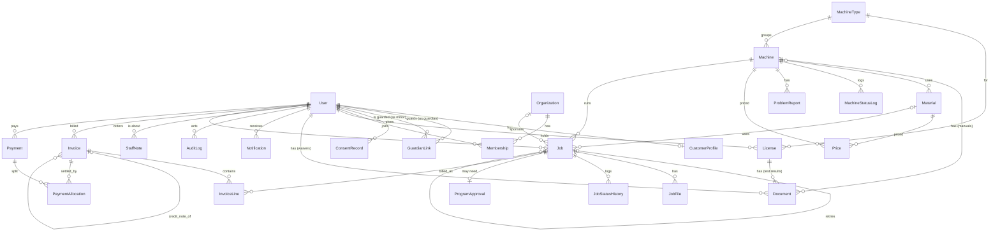

# Database schema (ERD)

Source of truth for the Django models. It matches the SRS (sections 3, 5.2 and 11) and every screen on the UI canvas. Change this file in a PR before changing a model.

- **Job is the hub.** It points to a customer (User), a Machine and a Material. Each InvoiceLine points back to one Job.
- **Money** is `DecimalField(max_digits=14, decimal_places=3)` (JOD with fils), never float. The API sends amounts as strings.
- **Django adds** `id` primary keys, `created_at`/`updated_at` (via an abstract `TimeStamped` base) and the MachineMaterial join table (a `ManyToManyField` on Machine).
- **Translated text** fields come as `_ar`, `_en` and `_fr` columns (for example `name_ar`, `name_en`, `name_fr`).

28 tables: 19 core and 9 added for the screens and later requirements (marked *new*).

## Relationships

## Tables

### People and organizations

**User** (custom `AbstractUser`, in the first migration)

| Field | Type / key | Notes |
| --- | --- | --- |
| `id` | PK | |
| `email` | varchar unique | Login name |
| `password` | hash | Argon2 or bcrypt |
| `mobile` | varchar | E.164, default +962 |
| `role` | enum | customer, guardian, staff, finance, program_manager, admin |
| `locale` | enum | ar / en / fr |
| `theme` | enum | light / dark / system |
| `digit_style` | enum | western / eastern |
| `mfa_enabled` | bool | django-otp TOTP device holds the secret |
| `is_active` | bool | Deactivate, never delete (FR-10) |
| `email_verified_at` | timestamp, null | FR-02 |

**CustomerProfile**

| Field | Type / key | Notes |
| --- | --- | --- |
| `user_id` | PK, FK User | |
| `full_name_ar`, `full_name_en` | varchar | |
| `category` | enum | public, student, school, sme, industry, program, internal |
| `university`, `student_id` | varchar, null | |
| `student_verified_at` | timestamp, null | Staff verify (FR-03) |
| `company_name`, `tax_number`, `billing_address` | varchar, null | Printed on invoices (FR-04) |
| `gender` | enum, null | female / male / prefer_not; analytics only |
| `date_of_birth` | date, null | Under 18 needs a GuardianLink |
| `overdue_block_override` | bool | Staff override (FR-63) |

**GuardianLink** *new*

| Field | Type / key | Notes |
| --- | --- | --- |
| `guardian_id` | FK User | |
| `minor_id` | FK User | |
| `consent_at` | timestamp, null | Null = no consent yet, minor can't submit |
| `approve_each_job` | bool | Guardian page setting |
| `photo_consent` | bool | |
| `withdrawn_at` | timestamp, null | Pauses the minor's account |

**ConsentRecord** *new*

| Field | Type / key | Notes |
| --- | --- | --- |
| `user_id` | FK User | |
| `document` | enum | privacy / terms |
| `version` | varchar | e.g. 1.0 |
| `accepted_at` | timestamp | FR-09 |

**Organization**

| Field | Type / key | Notes |
| --- | --- | --- |
| `id` | PK | |
| `name` | varchar | |
| `kind` | enum | company / university_team / program |
| `billing_name`, `tax_number` | varchar, null | |
| `budget` | decimal(14,3), null | Programs only |
| `member_allowance` | decimal(14,3), null | Programs only |
| `created_by` | FK User | |
| `deleted_at` | timestamp, null | Soft delete; past jobs stay linked |

**Membership**

| Field | Type / key | Notes |
| --- | --- | --- |
| `user_id` | FK User, null | Null while an emailed invite is pending |
| `organization_id` | FK Organization | |
| `invited_email` | varchar, null | |
| `role` | enum | member / admin / manager (program manager) |
| `status` | enum | invited / active / left / removed |
| `joined_at` | timestamp, null | |

**License**

| Field | Type / key | Notes |
| --- | --- | --- |
| `user_id` | FK User | |
| `machine_type_id` | FK MachineType | |
| `signed_by` | FK User | Staff |
| `issued_at`, `expires_at` | date | |
| `revoked_at` | timestamp, null | |

**Document** *new* (FR-97)

| Field | Type / key | Notes |
| --- | --- | --- |
| `machine_id` | FK Machine, null | Manuals, safety sheets |
| `customer_id` | FK User, null | Signed waivers, contracts (staff-only) |
| `license_id` | FK License, null | Training test results (staff-only) |
| `title` | varchar | |
| `file` | path | Private storage, signed URLs; same checks as JobFile |
| `uploaded_by` | FK User | Staff |
| `created_at` | timestamp | |

Exactly one of `machine_id`, `customer_id`, `license_id` is set (database check constraint).

**StaffNote** *new*

| Field | Type / key | Notes |
| --- | --- | --- |
| `customer_id` | FK User | Never shown to the customer |
| `author_id` | FK User | |
| `text` | text | |

**Notification**

| Field | Type / key | Notes |
| --- | --- | --- |
| `user_id` | FK User | |
| `kind` | varchar | job_ready, invoice_issued, ... |
| `payload` | json | ids and amounts for the template |
| `read_at` | timestamp, null | |
| `emailed_at` | timestamp, null | |

**AuditLog** (django-auditlog)

| Field | Type / key | Notes |
| --- | --- | --- |
| `actor_id` | FK User, null | |
| `action` | enum | create / update / delete / override / login / role_change |
| `entity`, `entity_id` | varchar, int | |
| `before`, `after` | json | |
| `ip`, `user_agent` | varchar | |
| `created_at` | timestamp | Append-only |

### Machines, materials and prices

**MachineType**

| Field | Type / key | Notes |
| --- | --- | --- |
| `id` | PK | |
| `code` | varchar unique | fdm, resin, laser, cnc, vinyl, ... |
| `name_ar/en/fr` | varchar | |
| `pricing_unit` | enum | per_gram, per_ml, per_minute, per_hour, per_metre, quote_only |
| `field_schema` | json | Job fields this type needs |
| `approval_rule` | enum | always / never / over_grams |
| `approval_threshold_g` | int, null | e.g. 100 |
| `risk_level` | enum | low / high (high needs license) |

**Machine**

| Field | Type / key | Notes |
| --- | --- | --- |
| `id` | PK | |
| `machine_type_id` | FK MachineType | |
| `code` | varchar unique | FL-PXL-01 |
| `name_ar/en/fr`, `model` | varchar | |
| `status` | enum | available, in_use, reserved, maintenance, out_of_service, retired |
| `status_note` | varchar, null | Shown to customers |
| `build_x_mm`, `build_y_mm`, `build_z_mm` | int, null | Fit check (FR-85) |
| `time_rate` | decimal(14,3) | Per pricing_unit |
| `setup_fee`, `min_charge` | decimal(14,3) | |
| `rounding_minutes` | int | e.g. 30 |
| `requires_license` | bool | |
| `qr_token` | varchar unique | Random; reset issues a new one (FR-93) |
| `scan_count` | int | |
| `photo` | image, null | JPG/PNG/WebP, max 5 MB, stored resized to 1600×1000 and a 320×200 thumbnail. Shown on /machines, /m/:token and the admin list; a type illustration is shown when empty |
| `photo_alt_ar/en/fr` | varchar, null | Photo description for screen readers |

**MachineStatusLog** *new*

| Field | Type / key | Notes |
| --- | --- | --- |
| `machine_id` | FK Machine | |
| `from_status`, `to_status` | enum | |
| `reason` | varchar | |
| `expected_return` | date, null | |
| `actor_id` | FK User | |

**ProblemReport** *new*

| Field | Type / key | Notes |
| --- | --- | --- |
| `machine_id` | FK Machine | |
| `reporter_id` | FK User | |
| `text` | text | |
| `photo` | file, null | |
| `status` | enum | open / resolved |
| `resolved_by` | FK User, null | |

**Material**

| Field | Type / key | Notes |
| --- | --- | --- |
| `id` | PK | |
| `name_ar/en/fr` | varchar | |
| `unit` | enum | g, ml, sheet, m, piece |
| `density` | decimal, null | g/cm³, for volume → grams |
| `colors` | json | |
| `stock_qty`, `reorder_level` | decimal | Drops from recorded actuals |
| `customer_supplied_allowed` | bool | |

**MachineMaterial** (auto join table)

| Field | Type / key |
| --- | --- |
| `machine_id` | FK Machine |
| `material_id` | FK Material |

**Price**

| Field | Type / key | Notes |
| --- | --- | --- |
| `category` | enum | Customer category |
| `machine_id` | FK Machine, null | Time price |
| `material_id` | FK Material, null | Material price |
| `item` | enum, null | setup, operator_time, tool_wear, ... |
| `unit_price` | decimal(14,3) | |
| `effective_from`, `effective_to` | date | Jobs keep a snapshot |

**Discount** *new*

| Field | Type / key | Notes |
| --- | --- | --- |
| `code` | varchar unique, null | Promo code, e.g. MAKERWEEK |
| `name` | varchar | |
| `scope` | enum | category / customer / organization / everyone / first_job |
| `percent`, `amount` | decimal, null | One of the two |
| `valid_from`, `valid_to` | date, null | |
| `stackable` | bool | Default false: only the largest applies |

**LabSettings** *new* (one row today; becomes Site when more sites are added)

| Field | Type / key | Notes |
| --- | --- | --- |
| `name_ar/en/fr`, `address`, `email`, `tax_number` | varchar | |
| `logo` | file | |
| `opening_hours`, `holidays` | json | |
| `tax_rate` | decimal | 16 or 0 |
| `payment_terms_days`, `pickup_days` | int | |
| `overdue_block_amount` | decimal(14,3) | |
| `invoice_prefix` | varchar | INV-AMM- |
| `file_retention_days` | int | 180 |
| `actual_vs_estimate_warn_pct` | int | 20 |

### Jobs

**Job**

| Field | Type / key | Notes |
| --- | --- | --- |
| `id` | PK | |
| `ref` | varchar unique | JOB-AMM-2026-000123 |
| `customer_id` | FK User | |
| `organization_id` | FK Organization, null | Sponsor or company |
| `machine_id` | FK Machine | |
| `material_id` | FK Material, null | |
| `title`, `notes` | varchar, text | |
| `fields` | json | Type-specific (color, infill, sheets...) |
| `mode` | enum | self / operator |
| `status` | enum | draft, submitted, under_review, approved, queued, in_progress, completed, invoiced, closed, rejected, canceled, failed, on_hold |
| `est_qty`, `est_minutes`, `est_total` | decimal, int, decimal(14,3) | From the quote |
| `actual_qty`, `actual_minutes` | decimal, int, null | Entered by staff |
| `override_reason` | text, null | Required when actual differs > 20% |
| `failure_reason`, `failure_policy` | enum, null | FR-47 |
| `parent_job_id` | FK Job, null | Retry of a failed job |
| `queue_position` | int, null | |
| `thumbnail` | file, null | From the 3D preview (FR-87) |
| `price_snapshot` | json | Prices used for the quote |

**JobFile**

| Field | Type / key | Notes |
| --- | --- | --- |
| `id` | PK | |
| `job_id` | FK Job | |
| `file` | path | Private storage, signed URLs |
| `original_name`, `size`, `sha256` | varchar, int, char(64) | |
| `dims_mm`, `volume_cm3`, `est_grams` | json, decimal, decimal, null | From trimesh |
| `scan_status` | enum | pending / clean / infected |

**JobStatusHistory**

| Field | Type / key | Notes |
| --- | --- | --- |
| `job_id` | FK Job | |
| `from_status`, `to_status` | enum | |
| `actor_id` | FK User | |
| `comment` | text, null | |
| `created_at` | timestamp | |

**ProgramApproval** *new*

| Field | Type / key | Notes |
| --- | --- | --- |
| `job_id` | FK Job, unique | |
| `organization_id` | FK Organization | The program |
| `over_amount` | decimal(14,3) | Part above the member's allowance |
| `status` | enum | pending / approved / billed_to_member |
| `decided_by` | FK User, null | Program manager |
| `decided_at` | timestamp, null | |

### Billing

**Invoice**

| Field | Type / key | Notes |
| --- | --- | --- |
| `id` | PK | |
| `uuid` | uuid unique | JoFotara-ready |
| `number` | varchar unique | INV-AMM-2026-00045 or CN-AMM-2026-00004 |
| `customer_id` | FK User | |
| `organization_id` | FK Organization, null | |
| `type` | enum | invoice / credit_note |
| `original_id` | FK Invoice, null | For credit notes |
| `reason` | varchar, null | Credit note reason |
| `subtotal`, `discount_total`, `sponsored_amount`, `tax`, `total` | decimal(14,3) | |
| `paid_total` | decimal(14,3) | Sum of allocations |
| `status` | enum | draft, unpaid, partially_paid, paid, overpaid, void |
| `issued_at`, `due_at` | timestamp, date | |

**InvoiceLine**

| Field | Type / key | Notes |
| --- | --- | --- |
| `id` | PK | |
| `invoice_id` | FK Invoice | |
| `job_id` | FK Job, null | |
| `description_ar`, `description_en` | varchar | |
| `qty`, `unit`, `unit_price` | decimal, varchar, decimal(14,3) | |
| `discount`, `sponsored`, `tax`, `line_total` | decimal(14,3) | |
| `pricing_inputs` | json | Engine version and inputs |

**Payment**

| Field | Type / key | Notes |
| --- | --- | --- |
| `id` | PK | |
| `number` | varchar unique | PAY-2026-00311 |
| `customer_id` | FK User | |
| `amount` | decimal(14,3) | Negative for refunds |
| `method` | enum | cash, card_pos, bank_cliq, wallet_credit, program_budget, other |
| `reference` | varchar, null | |
| `received_by` | FK User | Shows in that person's cash-up |
| `received_at` | timestamp | |
| `credit_note_id` | FK Invoice, null | For refunds |

**PaymentAllocation**

| Field | Type / key |
| --- | --- |
| `payment_id` | FK Payment |
| `invoice_id` | FK Invoice |
| `amount` | decimal(14,3) |

## Rules

- **Gap-free numbers:** invoice, credit note and payment numbers come from a per-series counter row, allocated inside `transaction.atomic()` with `select_for_update()`.
- **Issued invoices are never edited:** corrections are a new Invoice with `type = credit_note` and `original_id` set.
- **Payment status is derived:** an invoice's status comes from its PaymentAllocation sums (Unpaid, Partially paid, Paid, Overpaid, Void). Allocation pays the oldest selected invoice first.
- **Status changes go through one service:** every Job status change calls one service function that checks the allowed transitions (SRS 3.6), writes JobStatusHistory, sends notifications and updates the queue over WebSockets.
- **Program allowance:** a member's used amount is the sum of sponsored invoice lines for jobs in that program. A quote that goes over creates a ProgramApproval before the job can be queued.
- **Minors:** a user under 18 with no active GuardianLink consent can't submit jobs and can't self-operate any machine.
- **Optional personal data:** gender and date of birth are only used in aggregated analytics, and groups under 5 people are hidden.
- **Soft deletes:** users and organizations are deactivated, never deleted, so invoices keep their links.
